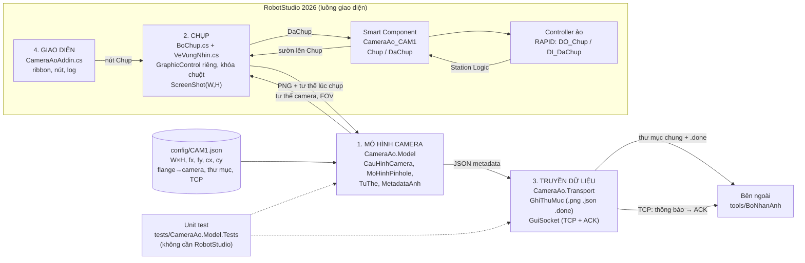

# Kiến trúc add-in "Camera ảo" (RobotStudio 2026)

| Phần | Project / file | Phụ thuộc RobotStudio? | Trách nhiệm |
|---|---|---|---|
| 1. Mô hình camera | `src/CameraAo.Model` | **Không** | Đọc/kiểm tra cấu hình; pinhole u = fx·X/Z + cx; FOV dọc = 2·atan(H/2fy); tư thế camera = mặt bích × flange→camera; tạo JSON metadata |
| 2. Chụp | `src/CameraAo.Addin/BoChup.cs`, `VeVungNhin.cs` | Có | Đặt góc nhìn từ mô hình (FieldOfView của RobotStudio là góc **ngang**, tính bằng **độ**), ép vẽ lại rồi `ScreenShot(W,H)`; vẽ hình chóp vùng nhìn trong View1 |
| 3. Truyền dữ liệu | `src/CameraAo.Transport` | **Không** | Ghi PNG → JSON → `.done` (ghi file tạm rồi đổi tên); gửi thông báo TCP, chờ `ACK n` |
| 4. Giao diện | `src/CameraAo.Addin/CameraAoAddin.cs` | Có | Ribbon "Camera ảo", nút, trigger, điều phối, log ra Output |
| Bên ngoài | `tools/BoNhanAnh` | Không | Nhận ảnh qua TCP hoặc quét thư mục; kiểm tra file + trường JSON; tổng kết N/N |

**Luồng một lần chụp:** trigger (nút hoặc sườn lên `Chup`) → tính tư thế camera từ mặt bích robot + cấu hình → đặt góc nhìn, ép vẽ lại → `ScreenShot(W,H)` → metadata (chỉ số, thời gian mô phỏng, tư thế camera trong World, intrinsic) → ghi thư mục + `.done` → (nền) gửi TCP, chờ ACK → bật `DaChup`.

**Quy ước:** hệ camera giống OpenCV (Z nhìn về trước, Y hướng xuống ảnh); mô hình dùng mm + độ; API RobotStudio dùng mét + radian (riêng `GraphicControl.FieldOfView` dùng độ và là góc **ngang**: đặt 2·atan(W/2fx), góc dọc tự ra 2·atan(H/2fy)).

**Giới hạn đã biết:** camera RobotStudio luôn có tâm ảnh ở giữa (cx = W/2, cy = H/2) và không có méo ống kính → cấu hình khác sẽ bị cảnh báo và ghi vào JSON (`canh_bao`); không mô phỏng độ sâu trường ảnh, nhiễu cảm biến.

**Kiểm chứng calib (v0.6):** 5 quả cầu ở tọa độ World biết trước (giữa + 4 góc ảnh), so tâm đo trên ảnh với phép chiếu pinhole → lệch 0.09–0.22 px (ngưỡng 3 px). Chính phép thử này phát hiện `FieldOfView` là góc **ngang**: bản cũ đặt góc dọc nên ảnh bị phóng W/H = 1.195 lần (lệch ~220 px ở góc ảnh). Xem trước trong cửa sổ camera chỉ vẽ lại khi tư thế camera đổi (trước đây 10 lần/giây làm View1 chậm).

**Tham khảo API:** [ABB.Robotics.RobotStudio.Stations.Camera](https://developercenter.robotstudio.com/api/robotstudio/api/ABB.Robotics.RobotStudio.Stations.Camera.html) — `FieldOfView` "in degrees" (tài liệu không ghi là góc ngang/dọc; góc **ngang** là kết quả kiểm chứng ở trên), `SetView(lookAt, lookFrom, upVec)`, `LockRotate/LockTranslate/LockZoom` (0 = khóa hẳn), mẫu `SyncCamera(cam, true, 0)` + `GraphicControl.Camera = cam`.
